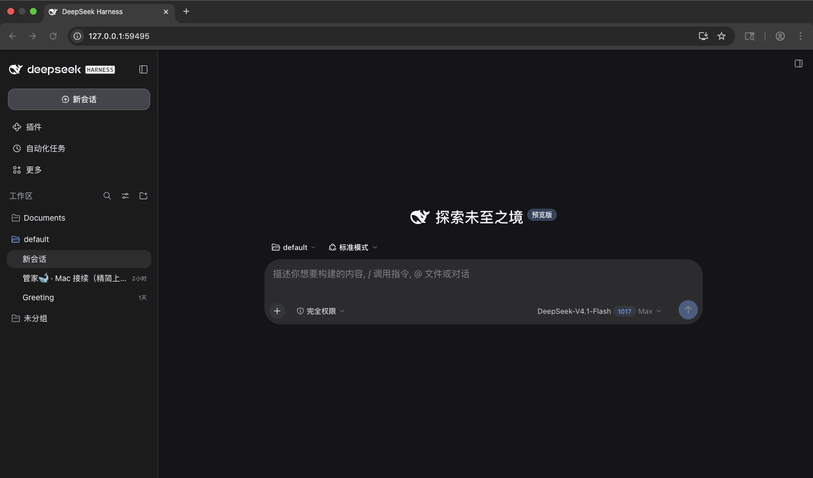

# dsh-mac-portable

> **非官方项目。** 本项目与 DeepSeek 无隶属关系，未获其赞助或背书；"DeepSeek Harness"
> 是 DeepSeek 的注册商标，本项目仅在描述性文字中使用该名称，项目名只用缩写 **DSH**。
> 详见 [`NOTICE.md`](NOTICE.md) 与 [`BRAND.md`](BRAND.md)。

**把官方 DSH 跑在 macOS Big Sur（11.x，Intel x64）上的可复现构建脚本。**
仓库里只有**自产脚本、补丁和文档**：不含上游任何源码、npm 包、二进制、`.asar`、`.app`、
`.zip`；构建时所需的字节全部由脚本从公开来源（nodejs.org、registry.npmjs.org）下载。

*This repository contains build scripts and documentation only — no upstream code,
npm packages, or binaries. It builds an **unofficial** DSH bundle for macOS 11 Big Sur
on Intel x64 by downloading the official npm package at build time.*



*在 macOS 上运行 `DSH.app` 后，由启动器在 `127.0.0.1` 随机端口拉起、用浏览器打开的会话界面。*

- 许可：[MIT](LICENSE)（自产部分）
- 目标系统：**macOS 11.0 Big Sur 及以上，仅 Intel x64**（Apple Silicon 需 Rosetta 2，未验证）
- 运行时：Node.js **v22.18.0** darwin-x64（SHA256 固定）
- 上游包：`@deepseek-ai/dsh@next`（或 `DSH_VERSION=0.2.1-rc.3` 等精确版本）
- 形态：`DSH.app`（POSIX sh 启动器 + 内置 Node + 内置 `node_modules`），双击后由启动器在
  `127.0.0.1` 随机端口拉起 `dsh web`，抓到一次性 token 地址后用浏览器打开

## B 档一键构建（推荐）

在 macOS 11+（Intel x64）上装好 Xcode Command Line Tools 后，一条命令完成全部五步：

```sh
git clone https://github.com/fys413/dsh-mac-portable.git
cd dsh-mac-portable
chmod +x make.sh scripts/*.sh verify.sh   # 从 zip 下载时可能丢失可执行位
./make.sh            # 默认不签名；加 --sign 做 ad-hoc 签名
```

预期产物：

- `build/DSH.app` —— 可双击的未签名应用；
- `dist/DSH-Portable-0.1.0-macos11-x64.zip` —— app + `LICENSES/` + `THIRD_PARTY_NOTICES.md`；
- `dist/SHA256SUMS` —— 校验和。

常用参数：`--skip-fetch`（复用 `build/`，离线重打包）、`--clean`、`--sign`、`--dmg`、
`--version X.Y.Z`、`--bundle-id ID`（默认 `io.github.<用户名>.dsh-mac-portable`，不得含
`deepseek`）、`--proxy http://127.0.0.1:7890`；`./make.sh --help` 列出全部选项且不写任何文件。

任何一步失败，`make.sh` 会打印**失败步骤、子脚本退出码、下一步提示**，并以该步的退出码
退出（1=步骤失败，2=用法错误，3=`--skip-fetch` 时 `build/` 不完整，4=缺 `codesign`）。
每一步都幂等，按提示处理后重跑即可。完整说明、预期产物和常见失败见
[`docs/BUILD.md`](docs/BUILD.md) 的 B 档章节。

---

## 1. 这是什么 / 不是什么

**是**：一套能在 Mac 上从零复现的构建脚本 —— 下载固定版本 Node、校验 SHA256、按
`darwin/x64` 平台装上游 npm 包、修补两个 Mach-O 的 `minos`、生成 `.app` 启动器和
`Info.plist`、打包成 zip。每个步骤都能单独重跑，产物可复现。

**不是**：不是 DSH 的发行版、不是官方构建、不是"下载即用"的二进制仓库。想直接用 DSH，
请走官方渠道（见 §9）。

## 2. 构建前置

| 依赖 | 要求 | 用途 |
| --- | --- | --- |
| macOS | 11.0+（Big Sur），Intel x64 | 构建与运行目标；脚本只能在 macOS 上跑 |
| Xcode Command Line Tools | `xcode-select --install` | 提供 `python3`（补丁脚本）、`codesign`/`otool`（排查用）；`/usr/bin/zip`、`ditto`、`hdiutil` 由系统自带 |
| Node.js | **无需预装**；脚本会下载 v22.18.0 darwin-x64 到 `build/runtime` 并校验 `9c8aa1e5…02cdc` | 运行时与 npm 客户端 |
| `unzip` / `7z`（p7zip） | `unzip` 系统自带；`7z` 仅在你想解压/核对**已有**的 dmg/zip 时需要 | 解包与校验 |
| 磁盘 | 约 **2 GB** 空闲（`build/` 约 735 MB，另需 zip 输出） | 运行时 + 依赖树 + 打包 |
| 网络 | 可访问 `nodejs.org`、`registry.npmjs.org`；构建时可选 `--proxy` | 下载 Node 与 npm 包 |

> 首次运行**构建产物**时仍需联网：DSH 会初始化 `~/.dsh/profiles/web` 并安装插件依赖。

## 3. 快速开始

```sh
git clone <your-repo-url> dsh-mac-portable
cd dsh-mac-portable

./scripts/fetch-runtime.sh      # ① Node 22.18.0 → build/runtime（SHA256 校验）
./scripts/fetch-dsh.sh          # ② @deepseek-ai/dsh@next → build/node_modules（darwin/x64，--ignore-scripts）
./scripts/patch-sherpa-minos.py # ③ 把 sherpa-onnx.node 的 minos 降到 11.0（自动备份原文件）
./scripts/build-launcher.sh     # ④ 生成 build/DSH.app（launcher + Info.plist + 组装 runtime）
./scripts/make-dmg-or-zip.sh    # ⑤ 打包 dist/DSH-macOS-BigSur-x64.zip（保留 0755，排除 .DS_Store）
./verify.sh                     # 仓库自检（语法 / 体积 / 无上游字节 / 无密钥）
```

每一步都可单独重跑；`scripts/*.sh` 都支持 `--help`。完整逐段说明见
[`docs/BUILD.md`](docs/BUILD.md)，常见问题见 [`docs/TROUBLESHOOTING.md`](docs/TROUBLESHOOTING.md)。

首次双击产物前，建议先读 [已知限制](#7-已知限制)：产物**未签名、未公证**，Gatekeeper 一定拦。

## 4. 目录说明

```
dsh-mac-portable/
├─ README.md                 # 本文件
├─ make.sh                   # B 档入口：按序执行五步，失败即停并给提示
├─ LICENSE                   # MIT（自产部分）
├─ NOTICE.md                 # 版权归属、上游 MIT、修改声明清单
├─ THIRD_PARTY_NOTICES.md    # 第三方组件、修改声明（sherpa minos）、LGPL 源码要约
├─ LICENSES/                 # Apache-2.0 与 LGPL-3.0 全文（随 zip/dmg 分发）
├─ BRAND.md                  # 落实上游 BRAND_GUIDELINES 的命名/图标/声明规则
├─ CHANGELOG.md
├─ .github/workflows/verify.yml  # CI：全部脚本 bash -n + verify.sh + 只读 --help
├─ .gitignore                # build/ dist/ *.zip DSH.app/ node_modules/ …
├─ .gitattributes            # 强制 LF（脚本在 macOS 上运行，CRLF 会坏）
├─ verify.sh                 # 仓库自检（不联网、不改文件）
├─ scripts/
│  ├─ fetch-runtime.sh       # 下载 + 校验 + 解压 Node 22.18.0 darwin-x64 → build/runtime
│  ├─ fetch-dsh.sh           # npm i @deepseek-ai/dsh@next --os=darwin --cpu=x64 --ignore-scripts
│  ├─ patch-sherpa-minos.py  # Mach-O LC_BUILD_VERSION.minos → 11.0.0（先备份）
│  ├─ make-icns.py           # 自带图标：PNG → .icns（纯 Python 写容器，不依赖 iconutil）
│  ├─ build-launcher.sh      # 生成 DSH.app/Contents/MacOS/DSH + Info.plist + 组装 runtime
│  └─ make-dmg-or-zip.sh     # zip（默认）/ dmg（--dmg），排除 .DS_Store，保留 0755
└─ docs/
   ├─ BUILD.md               # 逐步复现（含 --ignore-scripts、minos、polyfill 的原理）
   ├─ COMPLIANCE.md          # 三处合规缺口与修法（sherpa / libvips / polyfill）
   └─ TROUBLESHOOTING.md     # Safari 白屏、translocation、native addon、慢启动
```

构建产物（**被 `.gitignore` 忽略，永不入库**）：

```
build/
├─ runtime/node/{bin/node,lib/node_modules/npm,LICENSE}
├─ node_modules/@deepseek-ai/dsh/…
└─ DSH.app/Contents/{MacOS/DSH,Info.plist,PkgInfo,Resources/runtime/…}
dist/
└─ DSH-Portable-0.1.0-macos11-x64.zip
   ├─ DSH.app/…
   ├─ LICENSES/{Apache-2.0,LGPL-3.0}.txt
   └─ THIRD_PARTY_NOTICES.md
```

## 5. 产物与校验

- 结构：`DSH.app/Contents/MacOS/DSH` 是 POSIX sh 启动器；`Contents/Resources/runtime/`
  内含 `node/` 与 `node_modules/`；`Contents/Info.plist` 由 `build-launcher.sh` 生成，
  `CFBundleIdentifier` 默认 `io.github.<用户名>.dsh-mac-portable`（可用 `--bundle-id` 改，
  且不得含 `deepseek`），版本号来自 `--version`。
- 自定义图标：`python3 scripts/make-icns.py -s <你的 1024×1024 PNG> -o DSH.icns`
  （需 `pip3 install Pillow`，不调用 macOS 的 `iconutil`），再把 `DSH.icns` 放进
  `DSH.app/Contents/Resources/` 并在 `Info.plist` 设 `CFBundleIconFile=DSH`；仓库本身不带图标。
- 启动器行为：解析自身真实路径 → 单实例检测（`instance.lock`）→ 以无参数（或
  `DSH_PORTABLE_ARGS`）起服务、由 DSH 自选端口 → 从日志管道里抓
  `http://127.0.0.1:<port>/?token=…` → 优先 Chrome/Edge/Firefox 打开 →
  守护 Node 子进程；日志里 token 与 `Bearer` 一律打码为 `***`。
- 日志与状态：`~/Library/Logs/DSH-Portable/portable.log`、
  `service.url`（0600，含一次性 token）、`instance.lock`。
- 体积参考：`.app` 约 **735 MB**（61k 文件），zip 约 **237 MB**。GitHub 单文件硬上限
  100 MiB，所以产物**只能**走 Releases，绝不进 git。

## 6. 与上游的边界（A 档）

| 项目 | 是否在仓库内 | 说明 |
| --- | --- | --- |
| 自产脚本 / 文档 / 启动器模板 | ✅ 在 | MIT，版权归 contributors |
| 上游 DSH 源码或 npm 包 | ❌ 不在 | 构建时从公开 npm 拉取 |
| Node / npm / 依赖树 / LibreOffice / sherpa / libvips | ❌ 不在 | 构建时下载，用户自行承担再分发义务 |
| `.asar` / `.node` / `.dylib` / `.app` / `.zip` | ❌ 不在 | `verify.sh` 会检查 |

因此本仓库的许可义务几乎为零；但**你构建出来的包**需要补齐第三方声明，逐项清单和模板见
[`docs/COMPLIANCE.md`](docs/COMPLIANCE.md)。

## 7. 已知限制

1. **Safari 16 白屏**：Big Sur 自带的 Safari 16.x 缺少 `Promise.withResolvers`（Safari 17.4+
   才有），直接打开会白屏。前端已有 33 行 polyfill（见
   [`docs/COMPLIANCE.md`](docs/COMPLIANCE.md) §3），但 Safari 16 仍不可靠；启动器优先选
   Chrome/Edge/Firefox。**推荐 Chrome。**
2. **未签名、未公证**：没有 Apple Developer ID，首次启动一定被 Gatekeeper 拦。右键 → 打开，
   或 `xattr -dr com.apple.quarantine /Applications/DSH.app`。企业分发需自行签名+公证。
3. **只支持 Big Sur x64**：内置 Node 是 darwin-x64；Apple Silicon 只能靠 Rosetta 2，
   未在 M 系列真机验证；macOS 12+ 可用但未做兼容性承诺（minos 被下调到 11.0，向上兼容）。
4. **首次运行需要联网**：初始化 web profile 要装插件依赖；之后再启动可离线（除非用到联网功能）。
5. **构建机必须是 macOS**：脚本用 `shasum`、`ditto`、`hdiutil`、`plutil`；在 Windows/Linux 上
   交叉构建不在支持范围内（唯一的例外是 `verify.sh` 的文本自检可在任何平台跑）。
6. **语音输入为实验性**：`sherpa-onnx` 的 darwin-x64 预编译产物原始 `minos` 是 15.0，被本仓库
   下调到 11.0；改动未在真机验证。
7. **启动慢**：首次启动可能 1–5 分钟（网络差更久），启动器单次最多等 600 秒，可用
   `DSH_PORTABLE_WAIT_SECONDS` 调整。

## 8. 常见问题

Safari 白屏、App Translocation（"已损坏"、双击无反应）、native addon 加载失败
（`no suitable image found` / `mach-o, but wrong architecture`）、启动超时等问题，
见 [`docs/TROUBLESHOOTING.md`](docs/TROUBLESHOOTING.md)。

## 9. 从官方获取 DSH（推荐给只想用、不想构建的人）

- npm（公开）：`npm install -g @deepseek-ai/dsh@next`，或 `npx @deepseek-ai/dsh@next web`
- 官网下载页：<https://deepseek.com/harness>
- 源码与文档：<https://github.com/deepseek-ai/deepseek-harness>
- 版本核对：`npm view @deepseek-ai/dsh version dist-tags --json`

本仓库的脚本只是把上面这些**公开来源**组合成一个 Big Sur 可用的 `.app`；
DSH 本身的更新、支持与安全响应均由上游负责。

## 10. 许可与合规

- 自产部分：MIT，见 [`LICENSE`](LICENSE)；归属与上游声明见 [`NOTICE.md`](NOTICE.md)。
- 品牌规则：见 [`BRAND.md`](BRAND.md)（项目名只用缩写 DSH、`CFBundleIdentifier` 不用
  DeepSeek 反域名、显式"非官方"）。
- 再分发产物时必做的三件事见 [`docs/COMPLIANCE.md`](docs/COMPLIANCE.md)：
  sherpa-onnx（Apache-2.0 §4(a)/4(b)）、libvips（LGPL-3.0-or-later 源码要约）、
  前端 polyfill 修改披露。

## 11. English summary

`dsh-mac-portable` is an **unofficial**, script-only repository that reproduces a
macOS 11 Big Sur (Intel x64) bundle of DSH (DeepSeek Harness). `./make.sh` runs the
five steps in order (`fetch-runtime`, `fetch-dsh`, `patch-sherpa-minos`,
`build-launcher`, `make-dmg-or-zip`) and stops at the first failure with the step,
exit code and next hint. It ships **no upstream
bytes**: `scripts/fetch-runtime.sh` downloads the pinned Node.js 22.18.0 darwin-x64
tarball and verifies its SHA256; `scripts/fetch-dsh.sh` installs the public npm package
`@deepseek-ai/dsh@next` with `--os=darwin --cpu=x64 --ignore-scripts`;
`scripts/patch-sherpa-minos.py` lowers the Mach-O `LC_BUILD_VERSION.minos` of
`sherpa-onnx.node` from 15.0 to 11.0 (backing up the original);
`scripts/build-launcher.sh` emits the shell launcher + `Info.plist`;
`scripts/make-dmg-or-zip.sh` produces a zip that preserves `0755` and excludes
`.DS_Store`; `verify.sh` checks syntax, size, absence of upstream binaries and secrets.

Requirements: macOS 11+ on Intel x64, Xcode CLT (for `python3`), ~2 GB disk, network.
Known limits: unsigned/unnotarized (Gatekeeper will block), Safari 16 needs a
`Promise.withResolvers` polyfill (use Chrome), x64 only. Licensed MIT for the
self-authored parts; upstream DSH is MIT © DeepSeek and is **not** included here.
Not affiliated with or endorsed by DeepSeek. See `NOTICE.md`, `BRAND.md`, and
`docs/COMPLIANCE.md`.
